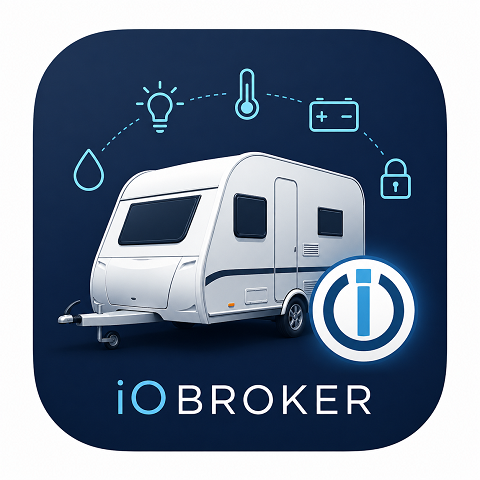

# ioBroker.mach

ioBroker adapter for **Adria caravans and motorhomes with the MACH box**
(MACH 2.0 / "MACH by Adria Mobil", manufactured by Solvesall d.o.o.).
Manufacturer page: [MACH app – Adria Mobil](https://www.adria-mobil.com/mach-app).

It connects to the MACH cloud with your own MACH account, the same way the
app does over LTE, and makes the box values available in ioBroker.

> **Unofficial project.** This adapter is not made, endorsed or supported by
> Adria Mobil or Solvesall. "Adria" and "MACH" are names of their respective
> owners and are used here only to describe what the adapter works with.
> The protocol was worked out independently to make the box interoperable
> with ioBroker. The manufacturer can change it at any time, which may break
> the adapter. Use at your own risk – especially when switching devices
> (heating!) remotely.

*A German summary is available in [docs/de/README.md](docs/de/README.md).*

## Features

- Reads **all values** of the box: at connect, every 15 minutes and a few
  seconds after every change the box reports. Values are named like in the
  app (`values.AIR_HEATER_TEMPERATURE`, `values.FRIDGE_VALUE`,
  `values.GAS_BOTTLE_LEVEL`, …), with scaling and value lists from the
  value table your own account downloads from the MACH backend.
- Live push updates for frequently changing values (`named.*`).
- **Heating can be switched** (`named.Heizung_Schalter`) and its target
  temperature set (`named.Heizung_Sollwert`, 0.5 °C steps). Verified on a
  real box.
- `control.reboot` restarts the box like "Restart MACH" in the app
  (at most once every 10 minutes).
- Sensitive values (Bluetooth PIN, SIM ICCID/IMSI, modem IMEI) are
  deliberately **not** stored as states.

Not yet: switching anything other than the heating (fridge, lights, pumps,
boiler). The protocol supports it, but it is not verified, so the adapter
does not offer it.

## Requirements

- An Adria vehicle with a MACH box and **active LTE connectivity** (the
  adapter talks to the box through the MACH cloud, not via Bluetooth/WiFi)
- A MACH app account that has the vehicle paired
- ioBroker with js-controller ≥ 5, admin ≥ 6, Node.js ≥ 18

## Installation

Install the adapter from the ioBroker admin: Adapters → search for "mach".
It is available there once it has been added to the ioBroker repositories.

## Configuration

| Field      | Value                                                       |
|------------|-------------------------------------------------------------|
| `username` | e-mail of your MACH app account                             |
| `password` | password (stored encrypted)                                 |
| `machId`   | 12 hex characters, e.g. `A1B2C3D4E5F6` (app → device settings) |

## States

| State | Meaning |
|---|---|
| `info.connection` | connected to the box |
| `info.lastAllValuesAt` | time of the last full state (ms) – use this to detect stale data |
| `info.lastFrameAt` | time of the last message from the box (ms) |
| `values.<NAME>` | every value of the box, named like in the app |
| `named.*` | live values from push messages; `Heizung_Schalter` and `Heizung_Sollwert` are writable |
| `control.reboot` | button: restart the box |
| `tlv.*`, `frames.*` | raw values the adapter cannot name yet (for analysis) |

The value table itself is saved to `0_userdata.0/mach/drivers.json` for
reference.

**Tip for automations:** only act on values when `info.lastAllValuesAt` is
recent (e.g. younger than 30 minutes). If the box loses LTE, the last values
stay in ioBroker.

## How it works

See [docs/PROTOCOL.md](docs/PROTOCOL.md).

## Contributing

Reports from other Adria models are very welcome – especially which values
your box reports (`values.*`) and whether the heating can be switched.
Please **never** post your password, `machId`, `sharedSecret`, tokens or
raw captures in issues.

## Changelog
<!--
    Placeholder for the next version (at the beginning of the line):
    ### **WORK IN PROGRESS**
-->
### 1.3.6 (2026-10-28)

- Read-only states no longer use `switch.*` or `level.*` roles: on/off values
  are `indicator`, temperatures `value.temperature`, everything else `value`.
  Objects created by older versions are updated on the next start.

### 1.3.5 (2026-10-28)

- No functional changes. Releases are tagged by a push again, so every
  release has a tag-triggered test run as the ioBroker repository check
  expects.

### 1.3.4 (2026-10-28)

- Settings page translations (`admin/i18n`) are now part of the npm package.
- Requires admin 7.6.20.

### 1.3.3 (2026-10-28)

- Settings page translated into 11 languages, with responsive layout.
- Timers are managed by ioBroker (`this.setTimeout`/`this.setInterval`).
- Requires Node.js 22, js-controller 6.0.11 and admin 7.6.17.
- Releases are published to npm via trusted publishing.

### 1.3.2 (2026-10-28)

First public release. Earlier versions were developed and tested privately
on one box (Adria Adora, MACH V2, LTE).

- Login via the MACH cloud, WebSocket with AES-128-CBC and HMAC-SHA1.
- Full state of the box at connect, every 15 minutes and shortly after
  every push message; values named from the value table of the backend
  (`values.*`).
- Heating on/off and target temperature can be written (verified live).
- `control.reboot` restarts the box (at most every 10 minutes).
- Bluetooth PIN, SIM ICCID/IMSI and modem IMEI are not stored as states.
- Logs show `machId` and user name only shortened; tokens never.

## License

MIT License

Copyright (c) 2026 Martin Vierling <vierling.martin@gmail.com>

The adapter is free software under the [MIT License](LICENSE): use it,
copy it, change it and share it, also commercially, as long as the license
text stays with it.

**What this license covers – and what not:**

- It covers only the code and documentation **written for this
  repository** (adapter, protocol description, logo).
- The author has **no rights** to the MACH app, the MACH box firmware, the
  MACH backend or any of their code, data or trademarks. These belong to
  Solvesall d.o.o. and Adria Mobil d.o.o. and are **not** licensed here.
- No code, files or data of the MACH app are included in this repository.
  The value table is downloaded at runtime from the MACH backend with the
  user's own account and is not part of this project.

See also [NOTICE](NOTICE).
